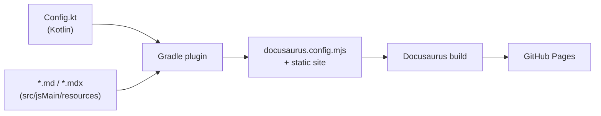

# Introduction

This site is a Kotlin/JS project. Nothing in it is a hand-written npm project:

- the site configuration is a Kotlin function (`src/jsMain/kotlin/io/github/shijianjs/ktjs/docusaurus/docs/Config.kt`),
- the pages below are Markdown files in `src/jsMain/resources/docs`,
- `./gradlew :docs:docusaurusBuild` assembles the site and runs Docusaurus on it.

```kotlin
@JsExport
fun docusaurusConfig(): Config = unsafeJso {
    title = "ktjs-docusaurus"
    url = "https://shijianjs.github.io"
    baseUrl = "/ktjs-docusaurus/"
}
```

The Gradle plugin writes `docusaurus.config.mjs`, imports the exported function from the compiled
module, and runs the Docusaurus CLI in a directory whose `node_modules` Gradle already installed.

## How the pieces fit together



A fence below is a diagram, not code — mermaid is enabled site-wide (`markdown.mermaid` and the
`@docusaurus/theme-mermaid` theme), and its palette lives in `themeConfig.mermaid`.
