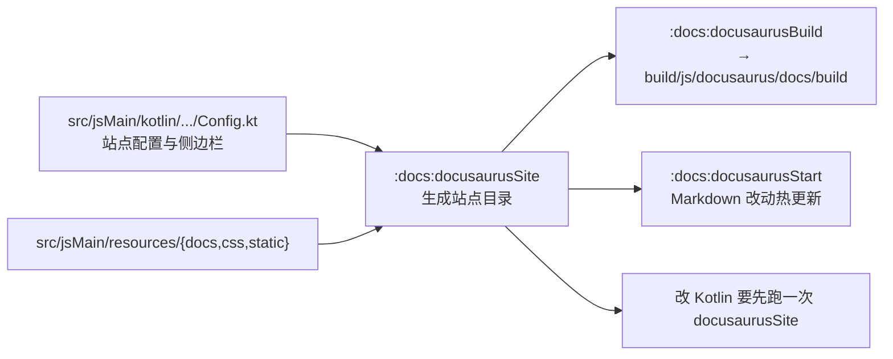

# 快速开始

## 环境要求

- JDK 21 或更新版本
- Gradle（wrapper 已随仓库提交）

Node 由 Kotlin/JS 插件提供；Docusaurus 各包来自同一个插件安装的 npm workspace。



## 构建站点

```bash
./gradlew :docs:docusaurusBuild
```

静态站点写到 `build/js/docusaurus/docs/build`。

## 用开发服务器开发

```bash
./gradlew :docs:docusaurusStart
```

Docusaurus 监听站点目录，所以改 Markdown 会刷新页面。改 Kotlin 需要先重新构建该模块：

```bash
./gradlew :docs:docusaurusSite :docs:docusaurusStart
```

## 各类文件的位置

| 路径 | 内容 |
| --- | --- |
| `src/jsMain/kotlin/io/github/shijianjs/ktjs/docusaurus/docs/Config.kt` | 站点配置与侧边栏 |
| `src/jsMain/resources/docs` | Markdown 页面 |
| `src/jsMain/resources/css` | 额外样式表 |
| `src/jsMain/resources/static` | 原样拷进构建产物的文件 |
