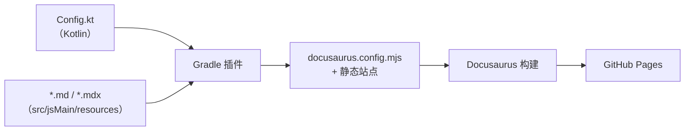

# 简介

本站本身就是一个 Kotlin/JS 项目，没有任何手写的 npm 工程：

- 站点配置是一个 Kotlin 函数（`src/jsMain/kotlin/io/github/shijianjs/ktjs/docusaurus/docs/Config.kt`），
- 下面的页面是 `src/jsMain/resources/docs` 里的 Markdown，
- `./gradlew :docs:docusaurusBuild` 组装站点并运行 Docusaurus。

```kotlin
@JsExport
fun docusaurusConfig(): Config = unsafeJso {
    title = "ktjs-docusaurus"
    url = "https://shijianjs.github.io"
    baseUrl = "/ktjs-docusaurus/"
}
```

Gradle 插件会写出 `docusaurus.config.mjs`，从编译产物里 import 那个导出函数，并在 Gradle 已经装好
`node_modules` 的目录里调用 Docusaurus CLI。

## 各部分如何协作



下面这段围栏就是一张图，不是代码——mermaid 在全站启用（`markdown.mermaid` 和
`@docusaurus/theme-mermaid` 主题），配色在 `themeConfig.mermaid` 里配置。
