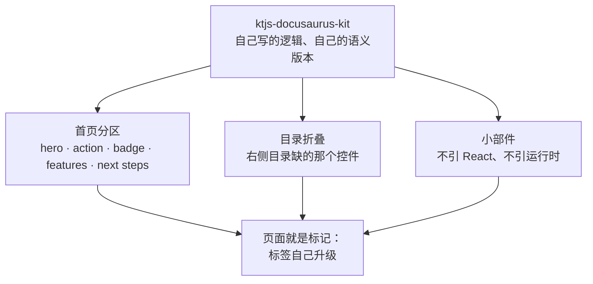

# 工具箱

`ktjs-docusaurus-kit` 不是 wrapper。wrapper（`ktjs-docusaurus`）映射 npm 包；工具箱里是自己写的逻辑，
直接对着 DOM，也不跟随上游版本——它有自己的语义版本。

它也不是「能用起来」的必备品：wrapper 加 Gradle 插件已经覆盖了 Docusaurus。工具箱是本项目按自己的喜好
给自家站点加的增强——npm 包不提供的那些零件——想用同样的外观和同样的目录行为时再依赖它。

它存在的理由是文档站需要三样 npm 包不提供的东西：

工具箱里的一切要么是自定义元素、要么是纯 DOM 部件，所以页面只写标签，从不 import 组件树。

- **首页分区**——hero、特性网格、"下一步"卡片。纯 DOM，构造时建一次，之后只通过 setter 更新。
- **目录折叠**——Docusaurus 只给左侧栏提供了 `themeConfig.docs.sidebar.hideable`，右侧目录没有折叠开关。
- **小部件**——不值得为它引入一个 React 组件或一套组件运行时。
